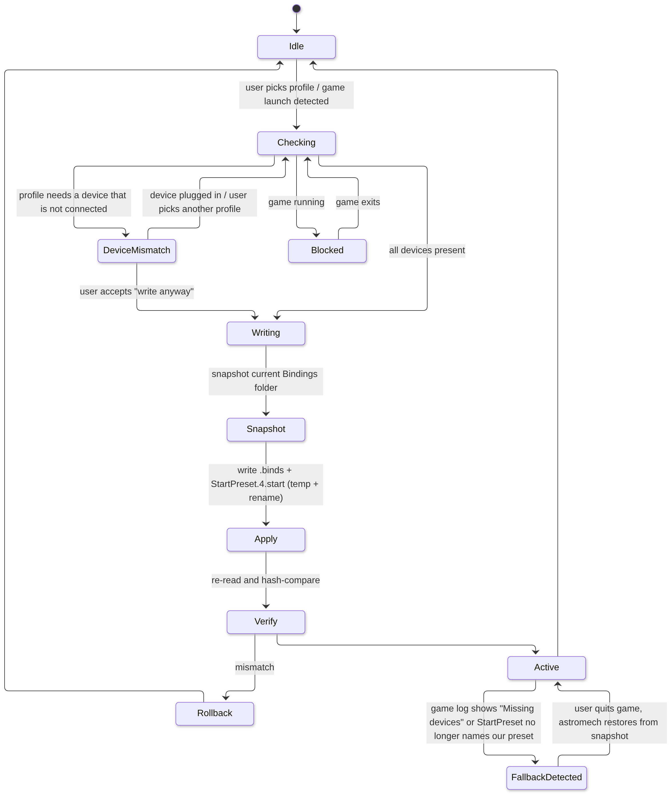

# astromech: Keybinds module (in the app window)

*Draft v0.8, 10 Oct 2026, 11:30 PM ET (America/New_York). Companion to ARCHITECTURE.md v0.10 (§5.4 `astromech-keybinds`, §18 app window and module architecture).*

**v0.8 changes (10 Oct, V1 design rev 3):**
- **Device pictures are the maker's own reference sheets**, bundled with credit. For Sumeet's pair:
  VKB's "Gladiator SCG (RH)" and "Gladiator SCG OTA (LH)" sheets, in `data/devices/vkb/`. Our
  labels go in the sheet's own form-field boxes. Own SVG line art is only the fallback for
  devices without a sheet.
- **Stock button maps ship built in** (`data/devices/vkb/*.json`): each control's factory
  `Joy_N`, from EDRefCard's MIT device data, checked against Sumeet's real presses.
- **Calibration is a fallback.** If a press lands somewhere the map doesn't expect, we ask
  about that one control. No "press every button" wizard.
- See V1-DESIGN.md §3 for the activity views that use these sheets.

**v0.7 changes (10 Oct, gear-down slice):** the Health check (§7.6) now runs inside `astromech-core`, **at startup and on every Bindings-folder change** (device plug/unplug, before-launch and on-import triggers come with the app window). It adds one copilot rule: each voice tool's action must have a pressable keyboard bind (a Keyboard slot whose modifiers are keyboard keys too), otherwise the tool refuses with a spoken hint. New module `astromech_keybinds::active` resolves the active preset per context (StartPreset, your files first, then built-ins) and builds the action → binding index; `astromech-input::listen::binds_index` now uses it. Results go to the console and `astromech-data/health.json`/`.html`.

**v0.6 changes (10 Oct):** the project is now **astromech**. `helm-binds` is `astromech-keybinds` (crates/astromech-keybinds, seeded from `k0-binds-doctor` with its tests). The listener lives in `astromech-input::listen`. Profile files use an `astromech_` prefix, and profile exports are `.astromechprofile.zip`.

**v0.5 changes (10 Oct):** the S7 listener is the seed of the key tester (§6.4). The duplicate-PresetName "DualVKB" on Sumeet's PC is recorded as a real-world health-check case (§7.6).

**v0.4 changes (10 Oct):**
- Sumeet reflashed his left stick with the correct VKB Omni firmware, and it now reports `231D3201`. The `0201` reading was caused by the wrong firmware profile, not by stock Omni behaviour (§2.6).
- §7.3: the auto-remap and bulk remap are dropped. A wrong-firmware warning with reflash steps replaces them, and a manual "replace device ID in a copy" stays as an advanced option.
- The binds doctor becomes the always-on **Health check** in profile management (§7.6). `k0-binds-doctor` is the seed of its crate.

**v0.3 changes (10 Oct, first binds-doctor run on Sumeet's PC):** §2.6 corrected: his stock left Omni Throttle reports `231D0201`, not `231D3201`. This is the first confirmed real-world case of the silent fallback. The PID-remap feature (§7.3) is strengthened, the Doctor gets a Joy_33+ rule, and K0 lists `k0-binds-doctor` as its first deliverable (§14).

**v0.2 changes (Sumeet's answers, 10 Oct):**
- "Keybinds Studio" is now the **Keybinds module of the app window**: one comprehensive app, not a suite (ARCHITECTURE §18).
- Svelte 5 + TypeScript is confirmed.
- **EDRefCard is parked:** no maintainer contact; the reuse notes are kept.
- **Middleman apps** (Steam Input, Joystick Gremlin, vJoy, DS4Windows, JoyToKey) are **out of scope**.
- New **§2.6:** Sumeet's VKB Gladiator NXT EVO pair is the first device-layout target and the test case for near-identical sticks.
- New feature **F10:** in-game button labels via Elite's `DeviceButtonMaps`.

**Conventions.**
- ⚠ UNVERIFIED marks anything not confirmed from a primary source or a test. Everything game-behavioural that matters is collected into spike **K0** (§13), which runs on Sumeet's PC.
- No code was copied from GPL projects.
- I read EDRefCard's MIT source (two repos, cloned to `/workspace/edrc` and `/workspace/edrc2`) for format and data facts only.
- Frontier's own files (default presets, `DeviceMappings.xml`) appear in EDRefCard's test folder. I read them for facts; **we never redistribute them**.

---

## 1. Problem statement

Elite's in-game controls screen is the only first-party editor. It has five structural problems:

1. **The single silent "Custom" profile.**
   - Editing any shipped preset writes the result to `Custom.<maj>.<min>.binds`, with `PresetName="Custom"` inside.
   - At start-up, a preset file loads only if **every device it references is present**.
   - If one is missing (a stick unplugged, a Virpil PID changed after a firmware flash, a wireless pad asleep), the game silently selects another preset. The *next* edit then overwrites `Custom`.
   - The game logs the reason in `Options/Bindings/BindingLoadingErrors.log` ("Missing devices: ArduinoLeonardo", "Failed to find GUID for device: GamePad"). It also leaves `Custom.4.1.binds.<number>.backup` files.
   - Sources: the Steam guide by Sighman (id 2865381752); Frontier forum threads 631419 and 634310; the Keybinds Backup page.
2. **Named profiles need hand-editing.** You copy the file and change `<Root PresetName="…">` to match. The game then lists it in the preset drop-down, and it never overwrites it as "Custom". This is the community's standard workaround (same sources).
3. **Hundreds of actions in one long list.** There are about 420 actions with no search. EDRefCard's catalogue has 420 controls in 12 groups; an Odyssey 4.0 file has about 376 top-level elements, including settings.
4. **No reverse lookup.** The only way to see what a button does is to try binding it and wait for the conflict warning.
5. **No presets for modern hardware.** The shipped presets target 2014–2020 devices (X52/X55/X56, Warthog, T.16000M, G940, DS4, XB360 pad). There's nothing for VKB, Virpil, Xbox Series or DualSense.

**Goal:** a Keybinds module in the app window that fixes all five, never presses keys, and never risks his bindings.

---

## 2. `.binds` and `StartPreset` format reference

### 2.1 Files and locations
| Item | Facts |
|---|---|
| User folder | `%LOCALAPPDATA%\Frontier Developments\Elite Dangerous\Options\Bindings`. On Linux/Proton it's under `compatdata/359320/pfx/...` (Steam guide comment) |
| User presets | `<Name>.<Major>.<Minor>.binds`, e.g. `Custom.4.1.binds`, `Custom.4.2.binds` (Odyssey/Live), `Custom.3.0.binds` (Horizons 3.8). The game creates `Custom.*` only after the first edit |
| Shipped presets | Live in the game install (`…\Products\elite-dangerous-odyssey-64\ControlSchemes\` ⚠ UNVERIFIED exact path). They're unsuffixed, e.g. `T16000MHOTAS.binds`, with `MajorVersion="1" MinorVersion="8"` and a `SortOrder` attribute. Alongside them are `DeviceMappings.xml` and `Help.txt` |
| Active selection | `StartPreset.4.start`: 4 lines, one preset name per controls section (general, ship, SRV, on-foot, in that order per Directive 47's docs; ⚠ verify the order in K0). The legacy `StartPreset.start` is 1 line. **Several numbered start files can coexist, and the highest-numbered one wins** (Directive 47 removes extra ones; ⚠ verify) |
| Diagnostics | `BindingLoadingErrors.log`: "There where errors when loading preset file: X", "Missing devices:", "Failed to find GUID for device: …", "multiple entries of binding … only the first will be used" |
| Game backups | `<file>.binds.<digits>.backup`, written on load errors (forum 632877) |

### 2.2 XML structure (from shipped presets and user files, Odyssey 4.0)
```xml
<?xml version="1.0" encoding="UTF-8" ?>
<Root PresetName="MyHotas" MajorVersion="4" MinorVersion="0">
  <KeyboardLayout>en-GB</KeyboardLayout>
  <MouseXMode Value="" /> <MouseSensitivity Value="1.00000000" />   <!-- settings: <Name Value=".."/> -->
  <YawAxisRaw>                                                       <!-- axis action -->
    <Binding Device="231D0200" Key="Joy_XAxis" />
    <Inverted Value="0" />
    <Deadzone Value="0.05000000" />
  </YawAxisRaw>
  <LandingGearToggle>                                                <!-- digital action -->
    <Primary Device="Keyboard" Key="Key_L" />
    <Secondary Device="231D0200" Key="Joy_12">
      <Modifier Device="231D0200" Key="Joy_5" />                    <!-- 0..n modifiers (chords) -->
    </Secondary>
  </LandingGearToggle>
  <UseAlternateFlightValuesToggle>
    <Primary Device="{NoDevice}" Key="" />
    <Secondary Device="{NoDevice}" Key="" />
    <ToggleOn Value="1" />                                          <!-- hold (0) vs toggle (1) -->
  </UseAlternateFlightValuesToggle>
  <HumanoidItemWheelButton>
    <Primary Device="Keyboard" Key="Key_LeftAlt"><Hold Value="1" /></Primary>  <!-- per-slot hold -->
    ...
```
| Element | Semantics |
|---|---|
| `Root@PresetName` | Display name in the drop-down. It **must be unique**: two files with the same name break recognition (Steam guide comment). Avoid spaces and shipped names (guide) |
| `Root@MajorVersion/@MinorVersion` | Must match the file-name suffix (forum 634310). In the samples: 1.8 (shipped), 2.0 and 3.0 (Horizons), 4.0 (Odyssey). 4.1 and 4.2 are reported for current files |
| Digital action | `<Primary>` and `<Secondary>`, each `Device`+`Key`, an optional nested `<Modifier>` list (several allowed, e.g. Ctrl+Alt+Space) and an optional `<Hold Value>`. Unbound means `Device="{NoDevice}" Key=""` |
| `ToggleOn` | A per-action child on actions that support hold-or-toggle. In the samples: 3,003 occurrences across 152 files |
| Axis action (`*Axis*`) | `<Binding>` (one slot), `<Inverted>`, `<Deadzone>` (0–1 float). Some axis actions also have button twins (`YawLeftButton`) and `*Alternate` variants (alternate flight values) |
| Settings | `<Name Value="…"/>` scalars: `ThrottleRange`, `YawToRollMode`, `MouseGUI`, `UIFocusMode`, `MuteButtonMode`, and so on. They're part of the preset, so a profile switch changes them too |
| Duplicates | The game uses the first occurrence and logs the rest (forum 632877) |

**Contexts.** The context lives in the action name, not in an attribute:
- On-foot actions start with `Humanoid…`.
- SRV actions end in `_Buggy`.
- Galaxy map uses `CamTranslate*` and `GalaxyMap*`; there are also camera and fighter actions.
- EDRefCard's catalogue groups them as Ship 112, OnFoot 79, Camera 63, SRV 51, Scanners 33, Galaxy map 20, Multicrew 16, Misc 14, UI 11, Head look 9, Fighter 8, Holo-Me 4.
- The four drop-downs (general, ship, SRV, on-foot) can each name a different preset file.

### 2.3 Device and key identifiers
- **Known devices get a symbolic name.** `DeviceMappings.xml` maps VID/PID (plus `<Alternative>` IDs) to a name: `GamePad` (about 40 XInput VID/PIDs), `SaitekX52`, `T16000M`, `T16000MTHROTTLE`, `ThrustMasterWarthogJoystick`, `LogitechG940Joystick`, `DualShock4`, `OculusTouch`, `vJoy`, `ArduinoLeonardo`, and others (about 50 names in the patch-8 copy).
- **Unknown devices are written as 8 hex digits, `VVVVPPPP`.** For example `231D0200` is VKB (VID 231D), PID 0200, and `33448198` is Virpil, 3344:8198.
  - Programmable devices (Virpil, VKB) can **change PID** after a firmware or profile change, and the game then treats them as a new device (forum 631419; Virpil's VPC tool can set the PID back).
  - The "GUID" in the error messages suggests a DirectInput instance GUID behind the name. ⚠ UNVERIFIED how two identical sticks (VKB left and right, same VID/PID) are told apart.
- **Fixed names:** `Keyboard`, `Mouse`, `{NoDevice}`.
- **Key names:**
  - Keyboard: `Key_A` … `Key_Numpad_Enter`. These are positional, saved as UK-layout labels (bindED fork README; already noted in ARCHITECTURE §5.4).
  - Mouse: `Mouse_1..` and `Mouse_XAxis/YAxis/ZAxis`.
  - Joysticks: `Joy_1..Joy_N` (up to `Joy_32` in 152 sample files; ⚠ UNVERIFIED whether the game supports more than 32 buttons or 4 hats per device), `Joy_POV1Up..POV4Right`, and axes `Joy_XAxis, YAxis, ZAxis, RXAxis, RYAxis, RZAxis, UAxis, VAxis`.
  - Gamepad: `Pad_A`, `Pad_LBumper`, `Pad_LTrigger`, `Pad_LStickX`, `Pad_DPadUp`, … plus some `GamePad_Back` spellings.
- **The numbering is DirectInput's:** Joy_N is the DirectInput button index, and the axis names are DirectInput slots. ⚠ UNVERIFIED that it always equals the HID usage order (it does for typical HID descriptors). K0 checks it per device by pressing each button.

### 2.4 How the game selects and loads (what's known)
1. At start-up it reads `StartPreset.N.start` (highest N) to get the 4 preset names.
2. For each one it finds the `.binds` file whose `PresetName` matches, with the current version suffix (user folder first, then shipped).
3. If any device in that file isn't present, the load fails, the reason is logged, and the game falls back to a default (keyboard/mouse or a detected-device preset). The named file stays on disk and **won't be offered in the drop-down while its devices are missing** (forum 634310).
4. The fallback is now in memory. The **first edit** in Controls saves to `Custom.*.binds` and rewrites `StartPreset` to `Custom`, overwriting the old custom file.

⚠ UNVERIFIED and testable in K0:
- (a) whether it re-reads `.binds` while running. Directive 47 says "only when it starts"; EliteIntel says "only re-reads its bindings when the Controls screen is opened". The difference matters only for "apply while running".
- (b) whether editing a *named* preset in game saves back to that named file or forks it to `Custom`.
- (c) what happens to `X.4.1.binds` when the game moves to 4.2. Does it migrate, ignore it, or hide it from the list?
- (d) whether `Caps Lock` at launch really changes bindings (anecdotal Steam comment).
- (e) which devices count as "present", e.g. powered but asleep wireless pads.

### 2.5 Safe external editing (the decision)
- **Write only when the game process isn't running.** This tightens ARCHITECTURE §5.4's "closed or main menu", because we can't tell whether the Controls screen is open, or whether the game will write over us on exit. The Keybinds module can *show* and *plan* edits while the game runs, then applies them when it exits (or right away if it isn't running).
- **Write procedure:**
  1. Snapshot the whole Bindings folder.
  2. Write `X.tmp` in the same folder, flush it, then `ReplaceFileW`/rename it atomically.
  3. Re-read it, then parse and compare.
  4. Keep the original line endings, encoding (UTF-8 with the `<?xml ... ?>` header) and any unknown elements: a lossless DOM edit using `quick-xml` events, not re-serialising a struct.
  5. Refuse if the file's hash changed since it was loaded.
- **Watch** the folder (`notify`). Any change made by the game is snapshotted automatically, so a silent overwrite of `Custom` is always recoverable.


### 2.6 First device target: Sumeet's VKB Gladiator NXT EVO pair

**Hardware** (VKB product pages: vkbsimcontrollers.com and flightsimcontrols.com):
- **Left hand:** Gladiator NXT EVO **Omni Throttle**. The SCG Premium Left grip sits on an Omni Throttle Adapter (OTA), which turns the gimbal into a 2-axis throttle.
- **Right hand:** Gladiator NXT EVO with the SCG Premium Right grip.
- **Each grip:**
  - Dual-action trigger (2 buttons) and a rapid-fire (pinky) trigger.
  - **3 four-way hats with centre push** (A3, A4, C1 per the EDCD map), plus the A1 hat module and the C1 button module that ship with it.
  - Red thumb button (A2), side button (B1), pinky (D1).
  - **8-way analog ministick with centre push**, as an X/Y axis pair (or a hat in firmware).
  - Lockable **twist (Z rotation)** with a MaRS sensor.
  - A red LED and an RGB LED.
- **Each EVO base:**
  - 2 MaRS axes (X/Y gimbal).
  - **Throttle wheel** (analog).
  - **Rotary encoder** (two buttons, one per direction).
  - **Auto-centring 3-position switch**.
  - 3 buttons (F1–F3).
- **Axes:** 6 analog axes per device: X, Y, twist, wheel, ministick X/Y. That's within Windows/DirectInput's 8-axis limit (r/hotas; VKB forum).

**Default logical layout (Elite names).** From EDCD **EliteCustomButtonNames** (MIT, © 2025 Richard Buckle; files `231D0200.buttonMap` and `231D3201.buttonMap`, which have identical structure):
| Elite key | Control |
|---|---|
| `Joy_XAxis` / `Joy_YAxis` | Gimbal X/Y (on the Omni Throttle these are the two throttle axes) |
| `Joy_RZAxis` | Twist |
| `Joy_ZAxis` | Base throttle wheel |
| `Joy_RXAxis` / `Joy_RYAxis` | Ministick X/Y |
| `Joy_UAxis`, `Joy_VAxis` | Present but unused by default |
| `Joy_POV1..4` | Hats A1, A4, A3, C1 (as POV) |
| `Joy_1`, `Joy_2` | Trigger stage 1 and 2 |
| `Joy_3` / `Joy_4` / `Joy_5` | A2 red / B1 side / D1 pinky |
| `Joy_6–10`, `Joy_11–15`, `Joy_16–20` | A3, A4, C1 hats as 4 directions + click (duplicated as buttons) |
| `Joy_21`, `Joy_22` | Brake push / pull (the 3-position switch) |
| `Joy_23–26` | Encoder 1 and 2, up and down |
| `Joy_27–29` | Base F1–F3 |
| `Joy_30` | Unlabelled |
| `Joy_31` | C1 long press (a firmware "tempo" function) |

So there are **about 31 buttons plus 4 POVs** per device.
- **This stock EDCD layout is the first device profile and the primary test target**, using Sumeet's `231D3201` (left Omni Throttle, after the reflash) + `231D0200` (right) pair. ⚠ Entries that look like author-specific tempo or virtual functions ("C1 Long Press" `Joy_31`, the second encoder `Joy_25–26`, `Joy_30`) should be inert on stock firmware. Verify them in the key tester and drop any that never fire.
- Licence: MIT, so we can import it with attribution.

**How Elite tells them apart.**
- VKB has no entry in `DeviceMappings.xml`, so Elite writes them by **VID+PID**. **VID `231D`** is used for all VKB devices (VKB forum).
- Default PIDs, per EDCD's device list:
  - **EVO Right `231D0200`**, EVO Left `231D0201`.
  - **Omni Throttle Left `231D3201`**, Omni Throttle Right `231D3200`.
- **Sumeet's hardware (10 Oct; measured with `k0-binds-doctor`):**
  - First run: left Omni Throttle read **`231D0201`** ("VKBsim Gladiator EVO L"); right stick **`231D0200`** ("VKBsim Gladiator EVO R"). Both declare **128 buttons, axes X/Y/Z/RX/RY/RZ and 1 hat**.
  - A downloaded `.binds` expecting `231D0200` + `231D3201` didn't load because `231D3201` was missing. This is the first confirmed real-world case of the silent fallback (§1).
  - **Cause: wrong firmware profile.** The left unit had plain-Gladiator-L firmware. After Sumeet **reflashed it with VKB's Omni Throttle firmware** in VKBDevCfg, it registers as **`231D3201`**, and the file loads. So `0201` on an Omni unit means wrong firmware, not normal stock behaviour (this corrects v0.3).
  - Current pair: **`231D3201` (left Omni) + `231D0200` (right)**. The PIDs differ, so Elite can bind both. Never assume a PID: always read it.
- **128 declared vs 32 read:** the firmware declares 128 buttons, but Elite reportedly reads only `Joy_1..Joy_32` (gotcha 2). Binds on `Joy_33+` **silently do nothing**. The Health check flags each one (rule D-J33), as `k0-binds-doctor` already does.
- Other users' PIDs can differ. Per a VKB forum moderator, PIDs "are extremely variable … each module affects the PID", so the device inventory always reads the real ID.
- **Two sticks with the same PID** (e.g. two right-hand EVOs, or two left grips) look like one device to Elite: the second stick doesn't work, or the bindings collide (r/EliteDangerous "2nd VKB Gladiator not working in Odyssey").
  - The supported fix is giving each a distinct **USB PID in VKBDevCfg** (Global → Common → USB PID), then reinitialising and recalibrating.
  - Hacking `DeviceMappings.xml` is unsupported, and game updates overwrite it (EDCD README).
- **Gotchas:**
  1. **The PID changes after a VKBDevCfg "Default" or reconfigure.** One owner's left EVO came back reporting as "Gladiator EVO R" after a reset (VKB forum t=7996). A new Omni Throttle can first appear with a plain Gladiator PID, until VKB's setup and calibration re-designate it (Reddit).
     - Either change turns the profile's device ID stale, so the game silently falls back (§1).
     - The Health check (§7.6) recognises these known VKB mix-ups (`3201` expected, `0201` present, and so on) and explains the fix (§7.3). It does not auto-remap.
  2. **Elite reads only the first 32 buttons per device** (VKB forum moderator; t=8001 and t=7381). The default EVO layout fits. VKB's "virtual controller" split (via VKBDevCfg) creates a second device ID, which we must treat as a second layout.
  3. The `Joy_6–20` hat duplicates mean one physical hat direction can fire both `Joy_POVn` and `Joy_N`. The key tester must show both, and the Doctor should warn about binding both to different actions.
  4. The Omni Throttle's X/Y is a throttle, not pitch/roll. Presets must map `Joy_YAxis` on the Omni device `231D3201` to forward throttle (⚠ the direction and centre detent depend on the OTA firmware variant; calibrate).

**Layout plan:** one **SVG grip drawing** (mirrored for L/R) plus one base drawing. Layout JSON for `231D0200`, `231D0201`, `231D3200` and `231D3201` shares control IDs, so only the art is mirrored. This is the first K5 target, and the K0/K4 test case.

### 2.7 In-game custom button labels (`DeviceButtonMaps`)
- Elite reads `<DeviceID>.buttonMap` files: XML with `<Joy_N>label</Joy_N>`, plus icon tokens such as `[ps4PadU]`.
- They live in `Options\Bindings\DeviceButtonMaps\`, which survives updates, unlike the `ControlSchemes` folder.
- The game then shows **our names** ("RGNX A4 Click") in its Controls screen and in its control hints.
- Source: the EDCD EliteCustomButtonNames README, citing Frontier's `DeviceButtonMaps\Readme.txt`. ⚠ Read that Readme on Sumeet's install for the full token list.
- **New feature F10:** the Keybinds module generates button maps from our layouts and calibration, so in-game labels match what the app shows.

---

## 3. Existing tools (context; nothing reused except where noted)
| Tool | What it does | Relevance and licence |
|---|---|---|
| **EDRefCard** (edrefcard.info) | Upload a `.binds` file and get printable per-device cards; "publish" adds it to a public list with a description; each published card has a download URL `/configs/<id>.binds` | Original repo `richardbuckle/EDRefCard`, **MIT**, archived; it says it's superseded by **`brammmers/edrefcard2`** (MIT, last commit 3 May 2025, changelog 1.4). Another fork, `LibreArbitre/edrefcard2` (Flask rewrite, MIT), also exists. Details in §9 |
| **Keybinds Backup** (Spacejock, Windows) | Backs up the folder; renames `Custom` to a named preset and fixes `PresetName` | Closed source (freeware); confirms the rename mechanics |
| **Directive 47** (d47 docs) | "Binding profiles": saves and restores `StartPreset*` plus the referenced `.binds` into named folders; refuses while the game runs; keeps a "before last load" safety copy; removes stray higher-numbered StartPreset files | The closest prior art to our profile design. Licence not checked (⚠); design only |
| **EliteIntel** (Bindings tab) | Used/missing binding tables, search, conflict rules, safe keyboard auto-assign, Draft/Apply/Revert with a stale-file check, backups | Good UX reference for list editing and conflict rules: an exact-chord match; `G` and `Shift+G` don't conflict. Licence not checked; design only |
| **bindED** (VoiceAttack plugin) | Reads `.binds` into VoiceAttack variables; per-layout key maps | Original: public domain (Gary Magenheimer licence note). The maintained fork is **GPL-3.0**, so read its docs only and don't copy code |
| **EDDI**, **COVAS:NEXT** | Read binds to press keys | Licences "Other"/varied; already referenced in ARCHITECTURE §5.4; not reused |
| **KeepMyKeybinds** (Niceygy) | A small binds-management utility | Repo has no description; not evaluated (⚠) |
| Vendor tools (VKB DevCfg, Virpil VPC Software, TARGET, Logitech G Hub/X56 software) | Program firmware button numbers, PIDs and virtual buttons | Can renumber buttons. We ship the factory numbering and fix only the controls that disagree (§6.2) |
| Star Citizen tools (SC Joystick Mapper, the community "Bindings" card generators) | Similar device-image-plus-hotspot approach | Confirms the layered-image model. No data reused |
| **SDL GameControllerDB** | Gamepad GUID to standard-button mappings | zlib licence (⚠ check the file header before vendoring). Useful only to *name* pads in the key tester. Elite already maps XInput pads to `Pad_*` |

---

## 4. Feature list with user flows

| # | Feature | Main flow |
|---|---|---|
| F1 | **Controller view** | Pick a device tab (auto-listed from the active profile plus connected devices). The device drawing shows each button and axis labelled with its actions, colour-coded by context. Hover shows all contexts and modifiers; click opens the edit drawer. A "layer" switch shows only Ship, SRV, On-foot, Galaxy map or Modifier+. "Print/Export PNG/PDF" makes EDRefCard-style cards |
| F2 | **Ship view** | A stylised ship diagram in Elite HUD style (orange on black, scanlines) with callouts per system (gear, lights, hardpoints, cargo scoop, FSD, supercruise, heat sink, chaff, shields cell, night vision, flight assist, silent running, landing camera…). Each callout lists its bindings (keyboard and device glyphs). A toggle switches between ship, SRV and suit diagrams. Click a callout to open the edit drawer |
| F3 | **Key tester** | Opens on the "Tester" tab. Press any key or button, or move any axis: the device lights up in F1, and a panel lists every action on that input by context, including chords ("with Joy_5 held: Night vision"). Held modifiers are shown, along with axis value, inversion and deadzone. **Read-only; it never sends input** |
| F4 | **Named profiles** | Profiles list: create (from current, from preset, from EDRefCard file), duplicate, rename, set "device setup" (e.g. "HOTAS+pedals", "Gamepad VR"), activate, compare, history and restore. Activation follows the safe flow in §7 |
| F5 | **Search and categories** | A global search box (Ctrl+K) for action names, synonyms ("lights" finds `ShipSpotLightToggle`), raw tags, key names ("Joy_12", "Shift+G") and devices. Results are grouped by our categories (§5.1); conflicts and unbound actions are filters |
| F6 | **EDRefCard bridge** | Import: paste an edrefcard.info `/binds/<id>` link and we fetch that one `.binds` file, then show a preview and device-compatibility report (missing or different devices, with a remap offer). Export: "Make a reference card" opens edrefcard.info with the file ready to upload (§9) |
| F7 | **Presets** | "New profile from preset": pick devices (detected ones are preselected), pick a play style, and preview in F1/F2 before creating (§10) |
| F8 | **Doctor** | Conflicts, missing keyboard binds for copilot actions (the existing astromech-keybinds audit), sections pointing at different presets, device-ID mismatches (wrong-firmware hint plus reflash steps; manual ID-replace copy), all run continuously as the Health check (§7.6), binds on `Joy_33+` (rule D-J33: silently dead, since Elite reads 32 buttons) |
| F9 | 3D ship | Deferred (§11) |
| F10 | **In-game button labels** | "Write in-game labels" generates `DeviceButtonMaps/<id>.buttonMap` for each device from its layout and calibration (§2.7). Uses the same safe-write rules |

**Edit drawer (shared by F1/F2/F3/F5).**
- It shows the action, its description, context and slots (Primary, Secondary or Axis), hold/toggle, and inverted/deadzone for axes.
- Click "Listen" to capture the next input from the core tap; chords are allowed.
- An instant conflict check runs within the same context group, using exact-chord rules.
- All edits go into a **draft** profile; "Apply" follows §7.

---

## 5. Data model

### 5.1 Canonical action catalogue (`astromech-keybinds/catalog/actions.toml`, MIT, ours)
```text
Action {
  id: "LandingGearToggle"          // exact .binds tag
  kind: Digital | Axis | Setting
  section: General | Ship | Srv | OnFoot          // which StartPreset line governs it
  context: Ship | Fighter | Srv | OnFoot | GalaxyMap | SystemMap | Camera | Ui | Multicrew | HoloMe | HeadLook
  category: "Flight › Landing"     // ours: ~25 human categories, two levels
  name, description, synonyms[]    // "gear", "undercarriage"
  toggle_capable: bool             // has <ToggleOn>
  twin_of: ["LandingGearToggle_Buggy"?]  // ship/SRV twins
  ship_part: Some("landing_gear")  // F2 callout id
  hide_if_same_as: [...]           // borrowed concept from EDRefCard
  copilot_action: Some(ActionId)   // link to ARCHITECTURE §9 tool catalogue
  since: "4.0"                     // game version it appeared in
}
```
- **Seed:** generated by a script from (1) the **user's own installed** shipped presets (the authoritative tag list for their game version, read at run time) and (2) EDRefCard's `controlsData.py` (MIT, 420 entries with group, name, type and order; credited in NOTICE).
- Human categories, synonyms and ship parts are written by hand.
- **Unknown tags** found in a user file are kept and listed under "Uncategorised (new in this game version)", so a game update never loses data.

### 5.2 Device and layout database (`astromech-keybinds/devices/*.json`)
```text
DeviceModel { id: "vkb-gladiator-nxt-evo-r", vendor, name,
              match: [{vid:"231D", pid:"0200"}, {elite_name:"..."}],
              layouts: ["default-firmware"], kind: Stick|Throttle|Pedals|Pad|Keyboard|Panel|Mouse }
Layout { id, art: "vkb-gne-r.svg", viewBox: [0,0,1000,1400],
         controls: { "Joy_1": {label:"Trigger stage 1", anchor:[512,380], box:[640,350,300,60], side:"right"},
                     "Joy_XAxis": {label:"Roll", anchor:[...], kind:"axis"} , ... },
         derived_from: "own" | "edrefcard:<template>" }
UserCalibration { device_instance, layout_id, overrides: {"Joy_17": "Hat2 Up", ...} }  // only for controls that disagree with the stock map
```
- Coordinates are in the SVG `viewBox` space, so they scale with the window. A label box is where text is auto-fitted; the anchor is where the leader line meets the control.
- **Generic fallback:** any unknown device gets an auto-generated grid layout (buttons 1..N, hats, axes as bars) from its reported capabilities. Every device works on day one; it just isn't pretty.
- **EDRefCard reuse:**
  - `bindingsData.py` (MIT) has 68 supported devices and 115 layout templates. They map Elite device IDs to templates, with per-control `x`, `y` and `width` in **pixel coordinates on their JPG images** (e.g. `'Joy_1': {'x': 2003, 'y': 557, 'width': 670}`).
  - We can import the **ID-to-model mapping and control lists** with attribution.
  - The **45–65 JPG images**: usable as fallback pictures with credit. For VKB we use VKB's own sheets instead (v0.8).
- **Device inventory at run time** (core): enumerate HID game controllers (VID, PID, product string, button, hat and axis counts) and compute the Elite-style ID `VVVVPPPP`, or the symbolic name via the **user's installed** `DeviceMappings.xml`.

### 5.3 Profiles (`%APPDATA%\astromech\binds\`)
```text
Profile { id: uuid, name: "HOTAS + pedals", elite_preset_name: "astromech_HOTAS_pedals",
          sections: {general, ship, srv, onfoot} -> Ref<PresetDoc>,   // usually one shared doc
          device_setup: [DeviceRequirement{elite_id, model_id?, optional:bool}],
          created_from: Preset|Import|Snapshot, notes }
PresetDoc { lossless XML DOM + parsed index }      // stored as the exact .binds text
History  { content-addressed blobs (sha256) + log.jsonl: {ts, profile, cause: user_edit|game_write|import|activate|restore, parent} }
```
- `elite_preset_name` is ASCII only, with no spaces, a `astromech_` prefix and is unique.
- The version suffix is taken from the game's current `Custom.*` or highest seen version (⚠ K0c).

---

## 6. View designs

All views are SVG in the WebView (§12). Each is a stack of layers:

`art` (device or ship line art) → `hotspots` (invisible hit regions) → `leaders` (lines from anchor to label) → `labels` (auto-fitted text with context colour chips) → `live` (tester highlights, axis bars).

Text fitting uses `getComputedTextLength` with a font-size step-down, then ellipsis plus tooltip. Layouts are data (§5.2), so adding a device means adding JSON and SVG, with no code changes.

### 6.1 Controller view (F1)
```text
┌ Profile: HOTAS+pedals ▾ │ Devices: [VKB R stick] [Virpil throttle] [Pedals] [Keyboard] │ Layer: All ▾ │ ⌕ ┐
│                                                                                                         │
│   ┌─ Trigger stage 1 ── Fire primary (Ship) · Fire (SRV) · Primary fire (On-foot)                         │
│   │      ╭────╮      ┌─ A1 hat ↑ ── Pips SYS · ⇧ Target ahead                                           │
│   ╰──────┤ ●  ├──────┤                                                                                  │
│          │    │      └─ Red btn ── Deploy hardpoints · ⇧ Night vision                                   │
│          │    │                                                                                         │
│   X axis ── Roll (Ship) · Steer (SRV)    [▮▮▮▮▯▯] dz 0.05 inv ☐                                         │
│          ╰────╯                                                                                         │
│ Legend: ■ Ship ■ SRV ■ On-foot ■ GalMap ⇧ = with modifier Joy_5        [Print card] [Export PNG]        │
└─────────────────────────────────────────────────────────────────────────────────────────────────────────┘
```
Rendering:
- One `<svg viewBox>` per layout, with labels placed by the layout `box` and `side`.
- Labels whose bindings collide get automatic vertical spreading (a simple 1-D force pass).
- Print uses a print stylesheet; PNG export goes through an offscreen canvas.

### 6.2 When a stick has been remapped (fallback only)
Each built-in device map gives the factory `Joy_N` for every control. Most sticks stay on the
factory profile, so nothing is asked. If a press arrives that the map doesn't expect (a number
the map doesn't use, or the user says "that's not where I pressed"), astromech asks about that
one control: "Which control did you just press?" and the user clicks it on the sheet. The answer
is saved as a `UserCalibration` override. Nothing else is asked.

### 6.3 Ship view (F2)
```text
┌ SHIP │ SRV │ SUIT ─────────────────────────────────────────────── ⌕ ┐
│  HARDPOINTS ────────┐                        ┌──── FSD / JUMP         │
│  U · Joy_2          │      ___/‾‾‾‾\___      │   J · Joy_20            │
│                     ╰──── /    ◇     \ ──────╯                        │
│  LIGHTS ── L ─────────── |  ═══╪═══   | ─────── CARGO SCOOP Home      │
│                           \___/‾‾\___/                                │
│  LANDING GEAR ── G · Joy_12 ──╯  ╰── HEAT SINK V · Joy_14             │
│  ▸ unbound: Silent running (no keyboard bind: copilot can't use it)   │
└───────────────────────────────────────────────────────────────────────┘
```
- The art is **our own generic ship silhouette** in SVG (top and three-quarter views). It isn't a Frontier ship model or render, because those are copyrighted assets.
- The style follows Elite's HUD: amber `#FF7100`-like strokes on black, an OFL font such as Exo 2 or Orbitron (⚠ pick one in design), and subtle glow via SVG `feGaussianBlur`.
- Callouts come from `ship_part` in the catalogue (about 25 parts for the ship, 12 for the SRV, 12 for the suit). A callout with no binding is drawn dim with a warning chip.

### 6.4 Key tester (F3)

> **Seed (v0.5):** `spikes/s7-input-listener` is the seed of the key tester and the input crate. It does read-only Raw Input `INPUTSINK` + XInput, Elite names (`Joy_N`, `Joy_POV1Up`, `Joy_XAxis`), and `--with-binds` labels from the active preset. S7 showed it works with Elite focused (ARCHITECTURE.md §17.7).
```text
┌ TESTER  (listening… press anything; Esc to stop; never sends input) ─────┐
│ Last input: VKB R stick · Joy_12   held: Joy_5 (modifier)                 │
│ ┌ Ship      : Night vision (chord Joy_5+Joy_12)   · Landing gear (alone)  │
│ │ SRV       : Lights (alone)                                              │
│ │ On-foot   : —                                                         │
│ │ Galaxy map: —                                                         │
│ └ Conflicts : none                                                        │
│ Axes: X ▮▮▮▮▮▯▯▯ -0.21 (Roll)  Y ▮▮▮▮▯▯▯▯ (Pitch)  Z ▮▮▮▮▮▮▮▯ (Throttle)   │
└───────────────────────────────────────────────────────────────────────────┘
```
Data path:
1. The core's read-only input tap (Raw Input for keyboard and mouse; HID/DirectInput for controllers, the same numbering as Elite, ⚠ K0) sends `InputEvent{device_id, key}` over WebSocket at ≤ 120 Hz, coalesced for axes.
2. The frontend looks it up in a reverse index `(device,key) → [(action, slot, modifiers)]` that the core builds.
3. The tester runs only while its tab is focused.

### 6.5 Search (F5)
- A command palette, plus a list view of all actions grouped by category, with Primary, Secondary, Axis and Hold/Toggle columns, virtualised.
- The query matches name, synonyms, tag, category, key name and device.
- Fuzzy matching runs client-side (`uFuzzy`, MIT ⚠ check, or a small own scorer) over about 450 rows, which is instant.
- Filters: context, unbound, conflicts, keyboard-missing, changed since snapshot.

---

## 7. Profile management design



1. **Named profiles map 1:1 to uniquely named Elite presets.**
   - Activating profile P writes `astromech_<P>.<maj>.<min>.binds` (`PresetName="astromech_<P>"`) and a `StartPreset.4.start` naming it on all 4 lines (or per section if the profile splits them).
   - It removes or renames stray higher-numbered StartPreset files, after a snapshot, following Directive 47.
   - Old `astromech_*` files of inactive profiles stay in the folder, so they also appear in the game drop-down as a manual fallback.
2. **We never use `Custom`.** On first run, any existing `Custom.*.binds` is imported as a profile called "Imported Custom (date)" and activated under its new name (with the user's OK).
3. **Avoiding the silent fallback:**
   - **Before launch:** the core watches for the game process (already planned). The app window and the tray warn: "Profile *HOTAS+pedals* needs VKB 231D:0200 and Virpil 3344:8198. Virpil isn't connected." The options are to switch to a matching profile, continue anyway (then don't touch Controls), or ⚠ write a temporary copy without that device's binds. This is optional: it's a convenience, but it could surprise users.
   - Pre-launch detection is best effort. The tray app can't hook into the launcher; it reacts when `EliteDangerous64.exe` starts, which is already after the game picked its devices (⚠ timing; K0). The real guard is therefore a **device-change watch** that warns *before* the user launches.
   - **After launch:** tail `BindingLoadingErrors.log` and watch `StartPreset*`. "Missing devices" or a StartPreset change away from `astromech_*` gives a loud desktop, VR and voice alert: "Elite fell back to default controls; don't edit controls. astromech will restore after you quit." A restore offer appears on game exit.
   - **Device ID mismatch (v0.4: warn and explain; no auto-remap):**
     - When a file's device is missing but a connected device has the same VID, the Health check shows a specific warning. Example: *"This file expects a VKB Omni left stick `231D3201`, but a plain left stick `231D0201` is connected. This usually means the wrong firmware profile. Reflash in VKBDevCfg."*
     - **Fix steps** (with a link to VKB's firmware/VKBDevCfg download page; ⚠ exact menu names to be confirmed on Sumeet's setup):
       1. Close Elite.
       2. In VKBDevCfg, load the Omni Throttle firmware/profile for that unit and flash it.
       3. Recalibrate.
       4. Re-run the Health check. The device should now read `231D3201`.
     - Known mix-ups live in a small table in the device DB (§5.2): VKB `3201↔0201`, `3200↔0200`, and `0200↔0201` for a left/right swap after a reset. Other vendors use the generic text: "same vendor, different product ID; check the device's configuration tool".
     - **Advanced (manual):** "Replace device ID in a copy". The user picks the old and new IDs. We write `<Name> (copy).<ver>.binds` with a unique PresetName and every `Device=` attribute rewritten; the original stays untouched. This is a trivial attribute rewrite on the lossless writer, for cases like forum 631419 (`3344:8198` → `3344:81CD`) where reconfiguring the device isn't possible. There's no auto-matching and no bulk mode.
4. **Backups and versioning:**
   - Every write, and every game-made change, produces a content-addressed snapshot of the folder.
   - Retention: everything for 30 days, then daily, then weekly (configurable).
   - **Semantic diff:** per action, "Joy_12 → Joy_14 on LandingGearToggle (secondary)", and settings changes. A raw XML diff is available too.
   - Restore runs through the same safe-apply flow.
5. **Export/import:** a profile becomes a `.astromechprofile.zip` (the .binds files plus `profile.json`). Plain `.binds` import and export also work.


### 7.6 Health check (the binds doctor, built in)

The binds doctor is part of profile management, not a separate tool.
- **Runs on:** app start; device plug/unplug; any change in the Bindings folder (the existing watcher); before launch (game-process detection, §7.3); and on import.
- **Real-world case (10 Oct):** on Sumeet's PC, two files share `PresetName "DualVKB"`. The listener had to pick one (the highest version suffix, `DualVKB.4.2.binds`). Elite's menu has the same ambiguity. This is exactly what the duplicate-PresetName check and its 'make unique' fix action are for.
- **Checks** (everything in `k0-binds-doctor`):
  - Device match: missing, unknown and duplicate VID:PID devices, the wrong-firmware hint, and buttons/axes/hats the device doesn't have.
  - Duplicate or built-in-clashing PresetNames.
  - Version suffix vs the current version, and the root version attributes.
  - XML well-formedness (line and column) and encoding/BOM.
  - Files in subfolders and look-alike files (`.binds.txt`, `(1)`).
  - StartPreset resolution per context.
  - Joy_33+ binds (D-J33).
  - Quoted `BindingLoadingErrors.log` lines.
  - Plus the F8 rules (conflicts, missing copilot keyboard binds).
- **Results per profile:** a green/amber/red badge in the profile list and the tray, with ranked reasons (confidence plus plain English, framed as hypotheses until K0 confirms them). Each reason comes with a fix action:
  - unique rename → copy
  - fix version suffix → copy
  - move out of subfolder or rename look-alike → with confirmation
  - reflash steps
  - manual device-ID copy
  - open the file at the XML error

  Fixes that write go through the safe-apply flow (game closed, snapshot first).
- **Code:** `k0-binds-doctor`'s parsers and rules (`binds.rs`, `devices.rs`, `game.rs`, `analyze.rs`) are the seed of the crate: the `astromech-keybinds::doctor` module plus the device inventory. The CLI stays available as a standalone diagnostic Sumeet can send to others.

---

## 8. Rendering and frontend technology (summary; the full evaluation is in §12)
Svelte 5 + TypeScript + Vite. Hand-written SVG components with layout JSON; no diagram library is needed. The print stylesheet handles cards. The deferred 3D view uses three.js. Protocol types are generated from Rust.

---

## 9. EDRefCard integration
**Facts:**
- **Licence:** MIT for both repos (Richard Buckle, 2017; "derived with permission from code originally developed by CMDR jgm"). We may reuse the code and data with the copyright notice. **Image provenance ⚠ UNVERIFIED** (see §5.2).
- **API: none.**
  - The site is a CGI/Flask app driven by an HTML form: `POST multipart/form-data` to `scripts/bindings.py` with `bindings` (the file), `show*` checkboxes, `styling` and `description` (publishing).
  - Public read URLs: `/binds/<id>` (card page), `/configs/<id>.binds` (raw file, as the page itself advertises), `/list` (published list) and `/devices`.
- **robots.txt** allows only `/index.html`, `/list` and `/devices` for all user agents (`Disallow: *` for the rest). So **no crawling or bulk mirroring** of published configs.
- The current maintainer and host aren't clear: the README points to `brammmers/edrefcard2`, and the site directs support to a Frontier forum thread (⚠).

**Status: parked** (Sumeet, 10 Oct). No contact with the maintainer and no network integration until the app is more than a concept.
- **What we keep:** the reuse notes above. EDRefCard's MIT data (device-ID-to-model table, control catalogue) may seed our catalogue with attribution; its JPGs aren't bundled.
- Plain local `.binds` import/export (F4) covers sharing for now.
- **Options for later** (none needs anything today):
  - (a) User-initiated single-file import from a pasted `/binds/<id>` link.
  - (b) An "open the site" export where the user uploads the file themselves.
  - (c) Automated upload, publishing or image reuse, only with the maintainer's permission. That would need Sumeet's go-ahead to make contact.

---

## 10. Preset strategy
- **Presets are ours (MIT), written as data**, not copies of Frontier's shipped files. Each preset is a "role map":
  `{role: "primary_fire", action: "PrimaryFire"}` plus per-device-model "role → control" tables.
- Generating a preset means instantiating it with the user's **actual** device IDs (`VVVVPPPP`) and calibration. That solves VKB/Virpil numbering differences.
- **Layers:**
  1. A device-specific layer (stick, throttle, pedals, pad).
  2. A **keyboard companion layer** that guarantees every copilot-used action (ARCHITECTURE §9) has a safe keyboard chord. The copilot needs keyboard binds; this reuses the EliteIntel-style "safe free key" rules.
  3. Optional style packs: "combat", "explorer", "VR no-keyboard" (modifier-heavy).
- **Initial device list** (to confirm with Sumeet's hardware):
  - Xbox Series/One pad (XInput `GamePad`).
  - DualSense/DS4 (native `DualShock4`; ⚠ how Elite names a DualSense without middleware is unverified).
  - VKB Gladiator NXT EVO L and R, VKB STECS.
  - Virpil Constellation Alpha L/R + MongoosT-50CM3 throttle.
  - Thrustmaster T.16000M + TWCS, T.Flight HOTAS One/4.
  - Logitech X56.
  - Keyboard + mouse.
- **Quality bar:** every preset passes the Doctor (no same-context conflicts, all copilot actions have keyboard binds) in CI. The **community contributes** presets as data PRs, and they're tested in a fake-device harness (ARCHITECTURE §13 `FakeGame`).

---

## 11. Deferred: interactive 3D ship
- **Approach:** three.js in the same WebView (an `<canvas>` view). Use a glTF model of a **generic ship of our own design**, or a CC0 asset (e.g. from Kenney or Quaternius, licence checked per asset). Not Frontier assets.
- Named nodes and animation clips (`gear_deploy`, `lights_on`, `hardpoints_deploy`, `scoop_open`, `fsd_charge`) bind to catalogue `ship_part`s.
- In the tester, pressing the bound input plays the clip, so the 3D view becomes a "demonstration" layer over F3.
- Optional: drive it from live `Status.json` flags (gear, lights, hardpoints, scoop) while playing, on the second-screen dashboard.
- **Effort:** about 3–4 weeks. Roughly 1–2 weeks for modelling and rigging the asset (the hardest part, best contracted or found as CC0), 1 week of three.js view, picking and clip mapping, and 0.5 week of performance work and the low-power mode (render on demand only).
- **Risk:** extra GPU use while the game runs. Mitigation: pause when hidden, no continuous render loop.

---

## 12. Architecture (moved)
The Tauri/WebView evaluation from v0.1 still stands. It now lives in **ARCHITECTURE.md §18**, widened from "Studio" to the **app window**: one Svelte 5 + TypeScript app shell in a Tauri v2 process, with keybinds as one module. That section also covers the module/domain-service design and the process model.

---

## 13. Risks
| Risk | Mitigation |
|---|---|
| Game behaviour differs from the forum lore (re-read timing, named-preset editing, version-suffix migration) | Spike **K0** before writing code that depends on it; conservative "game closed" writes |
| Game overwrites our files on exit or after an in-game edit | Folder watch plus automatic snapshots; we never use `Custom`; post-session diff and alert |
| DirectInput vs HID button numbering mismatch | K0 per-device check; calibration wizard; the tester shows our own numbering next to the Elite key name |
| Two identical devices (same VID/PID; see §2.6) | ⚠ Unknown how Elite distinguishes them; K0 with Sumeet's hardware if he has a pair |
| Image and layout licensing (EDRefCard JPGs, vendor art) | Own SVG art by default; EDRefCard is parked |
| Frontier file redistribution | Only read the user's installed copies; never ship them |
| WebView2 memory/GPU in game | Separate process; close it in game; S11 gate |
| Two UI stacks | Small egui surface (VR overlay only); generated types; one web app for the app window and the dashboard |
| Lossless XML round-trip bugs (encoding, ordering, unknown nodes) | Golden round-trip tests on all 152 EDRefCard sample files plus Sumeet's files: byte-identical when unedited |
| Users editing in game after we warned | Snapshots make it recoverable; restore on exit |

---

## 14. Phased plan (one developer; estimates ±30%)
| Phase | Scope | Effort |
|---|---|---|
| **K0 spike** (Sumeet's PC, game installed) | **First deliverable: `k0-binds-doctor`** (read-only Windows CLI, `k0-binds-doctor.zip`). It inventories HID/XInput devices and checks every `.binds` (version, XML, encoding, duplicate names, devices, Joy_33+), StartPreset and logs, then ranks the likely reasons a preset is hidden. **Results (10 Oct):** the first run read `231D0201` L + `231D0200` R (each declares 128 buttons, 6 axes and 1 hat). A downloaded file expecting `231D3201` was hidden for a missing device, which confirms the fallback hypothesis. The cause was the wrong firmware: after Sumeet reflashed the Omni firmware, the left stick reads `231D3201`. Next: answer §2.4 a–e. Confirm the 32-button limit in game (bind `Joy_33`). Check how the PIDs react to a VKBDevCfg reset, if he's willing. Check DirectInput vs HID numbering for his devices, how two identical devices behave, the exact StartPreset line order, and the location of `ControlSchemes`. A script plus a checklist; Sumeet runs the game steps | 2–3 days (plus 1 hour of his time) |
| **K1 core** | Lossless parser and writer; catalogue generator (installed presets + EDRefCard data); reverse index; device inventory and Doctor rules ported from `k0-binds-doctor` | 1.5 weeks |
| **K2 profiles** | Profiles, safe apply flow, snapshots, semantic diff, fallback detection, **Health check (§7.6)**: triggers, per-profile badges, fix actions, wrong-firmware warning, manual ID-replace copy; Custom import | 1.5 weeks (the dropped auto/bulk remap offsets the Health check UI) |
| **S11 + K3 app shell** | App shell (ARCHITECTURE §18) + `astromech-proto` + typed WS client; S11 measurements; keybinds module: list and search view; edit drawer with Listen; draft/apply | 2 weeks |
| **K4 tester** | Read-only input tap streaming, tester UI, live highlights | 1 week |
| **K5 controller view** | SVG layer renderer, label fitting, print/PNG, generic fallback, calibration wizard, ~8 device layouts (art time dominates) | 2.5–3 weeks |
| **K6 ship view** | Ship, SRV and suit art plus callouts | 1.5–2 weeks |
| **K7 presets** | Role maps, keyboard companion layer, 6–8 device presets, CI Doctor checks | 1.5 weeks (plus community testing on hardware we don't have) |
| ~~K8 EDRefCard~~ | **Parked** (§9) | — |
| **K8b in-game labels** | `DeviceButtonMaps` writer (F10) | 2 days |
| **K9 3D** (deferred) | §11 | 3–4 weeks |

**Keybinds module MVP = K0–K4** (about 6.5 weeks): it already fixes pain points 1–4. K5–K7 add the visual views and presets.

---

## 15. Questions for Sumeet
1. Is "profile writes only while the game is closed" acceptable? Live apply would need K0 to prove that a re-read on opening Controls is safe.
2. Odyssey/Live (4.x) only, or Horizons 3.8 too?
3. Ship view: one generic ship (recommended), or per-hull silhouettes later?
4. Do you want in-game button labels (F10) on by default? It writes files into your Bindings folder.
