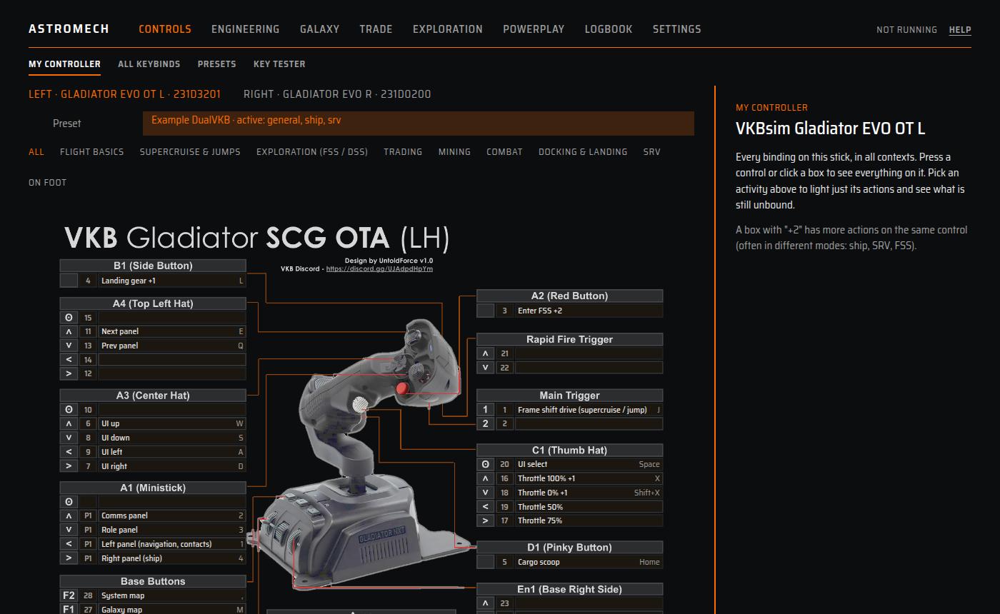
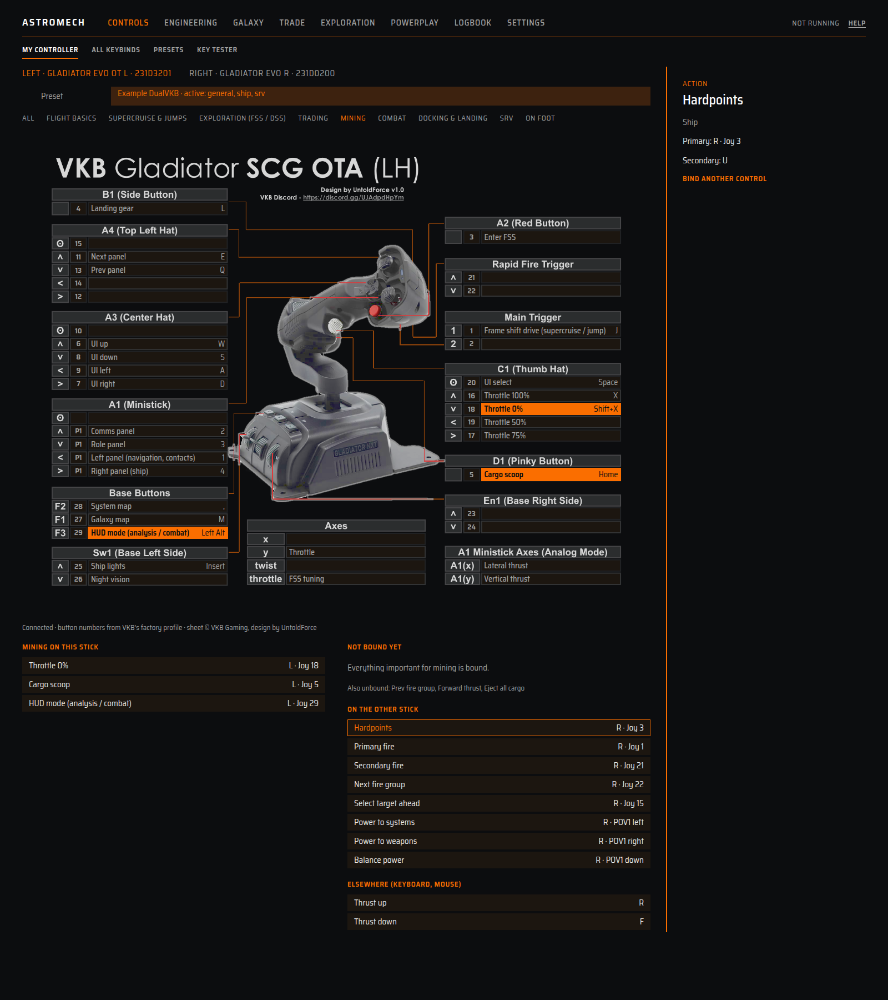
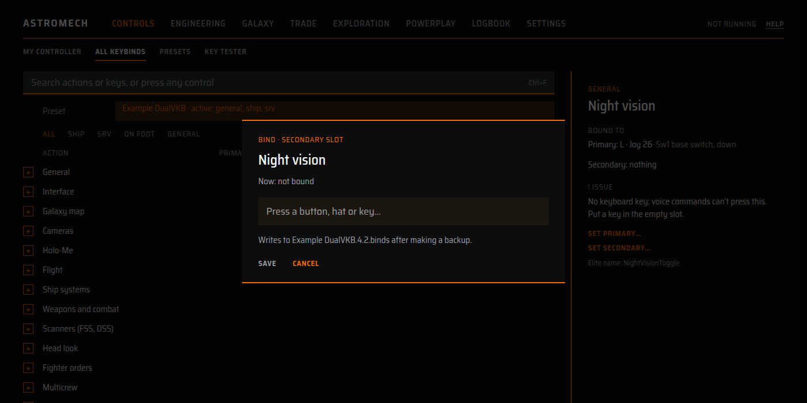

# Controls

Four pages under **Controls** show and fix your Elite keybindings: **My controller**, **All
keybinds**, **Presets** and **Key tester**. They read the Bindings folder Elite writes. Nothing
is changed unless you choose to bind something, and every change makes a backup first.

**What they need:** Elite's keybindings found (setup step 1), which exist after Elite has run
once. A connected controller helps but is not required. No network.

All of them listen to your sticks and keys while the window is open, so you can **press a
control** to find what it does. astromech only listens; nothing is sent to the game.

## My controller

Opens first. It shows one device as its maker drew it, with every binding in the sheet's own
boxes.

- Choose a stick above the sheet. Sheets are built in for the **VKB Gladiator EVO** (left
  Omni Throttle, device `231D3201`, and right stick, `231D0200`), drawn by VKB Gaming
  (sheet design by UntoldForce) and included with credit. Other makes have no sheet yet:
  use All keybinds.
- **All** shows every binding on the stick, in all contexts. Press a control or click a box to see
  what it does. A box with "+2" has more actions on the same control, often in different modes
  (ship, SRV, FSS).
- Pick an **activity** to light just that activity's actions: Flight basics, Supercruise and jumps,
  Exploration (FSS and DSS), Trading, Mining, Combat, Docking and landing, SRV, On foot. Below the
  sheet, **Not bound yet** lists the important actions with nothing on this stick, each with
  **Bind this**. **On the other stick** lists the ones bound only on your other stick, with the
  control. **Elsewhere** lists the ones bound only to the keyboard or mouse. astromech remembers
  the activity you chose, so the page opens on it next time.
- **Click an action** in any of those lists to see its slots and any issues in the panel on the
  right. **Bind another control** (or **Bind this**, if it has nothing yet) opens the bind dialog
  for it.
- Button numbers come from VKB's factory profile. If you pressed a control and the sheet does
  not know it (a stick you remapped in VKB's tool), it says so and asks "Which control did you
  just press?". Click it on the sheet and astromech remembers. A box marked "not confirmed" is a
  number inferred from the stock map; press it to check. **Use VKB's number again** undoes
  your correction.
- The **Preset** menu at the top picks which preset the page shows. It starts with the one the
  game uses for the ship. "Connected" or "Not connected" shows below the sheet.

## All keybinds

The game's Controls list, made searchable.

- **Search** by action name or key (**Ctrl+F**), or **press any control** and the list jumps to
  what it does.
- Filter by context: **All**, **Ship**, **SRV**, **On foot**, **General**. And by state:
  **All**, **Issues** (with a count) or **Unbound**.
- Groups open and close like the game's menu. Each row has Primary and Secondary slots. An
  empty slot looks empty.
- Click a row for the **about** panel: where it is bound, the control it is on your stick,
  and any issues, plus the game's own name for the action.
- **Double-click a slot**, or choose **Set primary** or **Set secondary**, to bind it.
  Axes use **Bind an axis**.

### What the health check flags

A marker appears on the row, with the reason in the about panel:

- **No keyboard key** (an error). astromech presses keys only, so each action it uses by voice
  needs a keyboard key: landing gear, lights, hardpoints, cargo scoop, night vision, flight
  assist, silent running, HUD mode, the galaxy map, system map, back, the left, right, comms and
  role panels, throttle to zero, and in the SRV the handbrake and drive assist. Put a key in the
  empty slot.
- **Joy number above 32** (an error). Elite reads only buttons 1 to 32 on each device. Anything
  higher is ignored.
- **Clashes with route paste** (a warning): V or Enter is on a galaxy map action. The route "paste" sends Ctrl+V, then Enter,
  while the galaxy map is open. If the search box does not have focus, a galaxy map action on one
  of those keys would run instead. Move that action to another key.
- **Device not connected** (a warning).
- **Same control as ...** (a note). Two actions in the same context share a control.
- A preset-level warning if a device's product ID looks different from what the preset names
  (for example after a firmware change).

### The bind dialog

**Bind this**, **Set primary**, **Set secondary** and **Bind an axis** all open the same dialog.

1. Press a button, hat direction or key (or move an axis). It shows the control, and warns "Also
   used by ..." if another action uses it. Both will respond to it.
2. **Save.** astromech first copies your preset into `astromech-backups` in the Bindings
   folder, then changes only that one slot. Everything else in the file is kept as it was.
3. Elite reads bindings when it starts. If Elite is running, open Options, Controls and pick the
   preset again, or restart it.

If the preset is one of Elite's built-in presets it cannot be edited. You name a copy
(default "<preset> astromech"), which goes in your Bindings folder and replaces the built-in
one where it is active. **Clear this slot** empties it.

## Presets

Every preset in your Bindings folder and Elite's built-in ones, and which is active for each
context (General, Ship, SRV, On foot).

- Click a cell to **use** a preset for that context. This writes the same `StartPreset` file
  as picking it in the game, after backing it up. Restart Elite, or pick it in Options, Controls,
  for it to take effect. **Use everywhere** sets all four.
- The side panel shows the preset's health, its devices, its files, and **Make a copy**. **Open
  in all keybinds** jumps to the list.
- **Backups** lists every backup astromech made, with **Restore**. Restoring backs up the
  current file first. They are in `astromech-backups` in the Bindings folder.

## Key tester

Press anything: a stick button, a hat direction, a key, a mouse button. Each press is listed with
the control it is (for a VKB stick), the name Elite uses (`231D3201 Joy_10`), and what the
shown preset does with it. Axes appear when they settle. The right side lists the controllers
Elite can see, with their buttons, axes and hats.

Use it to find what a button is called, to check that a stick reaches astromech (for
push-to-talk), or to see whether a button is bound.

The screenshots show astromech's built-in example preset, not a real one.

## Limits

- The sheets are for two VKB devices only.
- Bind this writes only the slot you choose. It never removes other bindings or edits curves and
  deadzones.
- A preset is read as Elite wrote it. Rules for which presets Elite lists are not documented by
  Frontier, so some health messages are best guesses.
- The window must be open to see presses; push-to-talk works from the tray without it.
