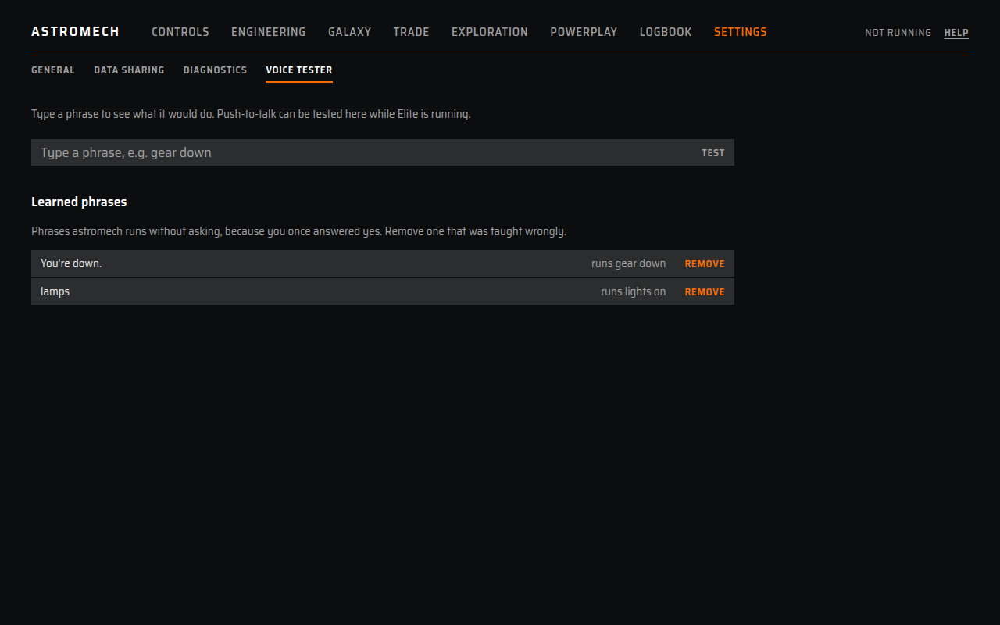

# Voice tester

Try a voice command without pressing anything in the game. It shows what astromech heard, which
command it matched, how sure it is and what it would do. Find it under **Settings**, then
**Voice tester**.

## How to use it

- **Type** a phrase, such as "gear down", and press **Test**.
- Or **use push-to-talk** with the page open and visible. The result appears as you speak.

While the page is open and visible, push-to-talk is in **test mode**: whatever you say is
tested, and astromech does not act on it or answer out loud. Minimise the window or leave the
page and push-to-talk goes back to normal within a few seconds.

## What it shows

| Row | Meaning |
|---|---|
| **Heard** | The words, and whether they were typed or spoken |
| **Intent** | The phrase it matched and its command id, or "No match" |
| **Confidence** | The match score, and what it leads to: "acts on it" (clear), "asks first" ("Did you mean ...?") or "too low to act" |
| **Would** | What would happen now: press the keys and say the confirmation, ask first, press nothing and say why (already, refused, no keyboard key, not available), answer a question, or ignore noise |
| **Keys** | The keyboard key from your Elite preset that would be pressed, or "No keyboard key for ..." |

"Nothing was sent to the game" is shown under every result. Lookups say what they would look
up ("Would look up the nearest Interstellar Factors on Spansh and say it") without asking.

## Run live

For a command that presses a key, **Run live** sends it to the game for real. Click it, then
switch to Elite within five seconds: astromech presses keys only while Elite is the active
window. It skips the "Did you mean" or "Confirm" question that a spoken command would ask.
It needs Elite running.

## Learned phrases

When you answer **yes** to "Did you mean ...?", astromech remembers what it heard and runs that
command next time without asking. The list at the bottom of the page shows each phrase and the
command it runs, the most used first. **Remove** forgets one at once, here and on disk, so a
wrong yes does not stay: astromech asks again the next time you say it.

## What it needs

- The speech models and a push-to-talk button, to test by voice. Typing works without them.
- Elite running, to test against your real ship state. Without it, typed phrases show the matched
  command and the keys, but ship actions read as not available.

## Limits

- It tests the matching and the checks, not Elite's reaction.
- Lookups are described, not run, so it never asks a website.
